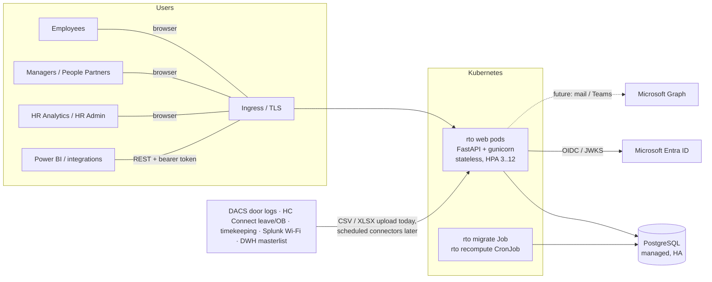
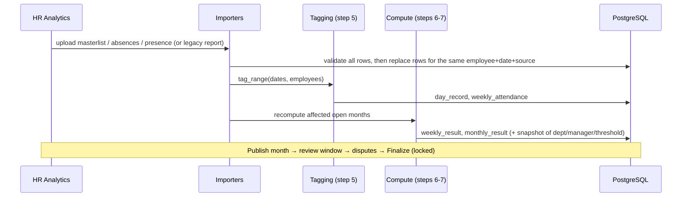

# Architecture

## Overview



- **One deployable**: a stateless Python web application serving the server-rendered UI and the JSON API.
  Sessions are signed cookies, so any pod can serve any request and the app scales horizontally.
- **PostgreSQL** is the only stateful component. All business data, results and the audit log live there.
- **Microsoft Entra ID** handles authentication. The app never sees passwords.
- **Batch work** (migrations, nightly recompute) runs as Kubernetes Jobs using the same image and the `rto` CLI.

## Layers

```
web/  api/  auth/         HTTP: forms, JSON, sessions, CSRF, error mapping
        │
services/                  use cases & transactions: compute, requests, access, org, policy, reports, months
        │
domain/                    pure functions: calendar, tagging, compliance (fully unit-tested, no I/O)
        │
models.py  db.py           SQLAlchemy 2 ORM, PostgreSQL (SQLite for fast tests)
importers/                 file → validated rows → services
```

Rules of the codebase:

1. **Policy logic lives only in `domain/`.** A rule change is a change in one small pure module plus its tests.
2. **Authorization lives in `services/access.py`** and is used by both the UI and the API. The two cannot drift apart.
3. **Every manual change writes an `audit_log` row** inside the same transaction.
4. **Results are materialised.** `weekly_result` and `monthly_result` are recomputed idempotently after every input
   change, so all read screens are simple indexed queries. This keeps the system fast with hundreds of concurrent
   managers.

## Data flow (process steps 3–9)



Approved requests apply their effect (commitment rows or day credits) and recompute only the affected employee
and months.

## Scaling model

Target: thousands of employees, hundreds of managers, about 400 people filing at the same time at peak.
Design headroom: 10,000 employees and 1,000 concurrent users.

| Concern | Approach |
|---|---|
| Web throughput | Stateless pods behind the ingress; gunicorn with N uvicorn workers per pod; HPA on CPU |
| Read latency | Materialised results; indexes on `(month, org_unit_id)`, `(month, manager_id)`, `(employee_id, …)`; the subtree is computed with a recursive CTE |
| Write bursts (filing) | Small transactions; recompute is scoped to one employee and the affected months |
| Bulk recompute | ~250k weekly rows per year at 10k employees; chunked bulk inserts (2,000 rows); can run as a Job |
| DB connections | `pool_size` + `max_overflow` per worker. Budget pods × workers × pool against the server's `max_connections`, or put PgBouncer (transaction mode) in front |
| Sessions | Signed cookie: no server-side session store needed |
| Metrics | Prometheus multiprocess mode, aggregated across gunicorn workers |

Load-test results are in [testing.md](testing.md).

### Next steps for scale (when needed)

- Move recompute after imports to a worker queue (for example Celery or RQ on Redis, or Azure Service Bus) so very large uploads return immediately.
- Add a read replica for reports and exports.
- Add per-user rate limiting at the ingress.

## Why server-rendered UI

The UI is Jinja2 + one small CSS file + 30 lines of JavaScript. There is no Node build, no CDN dependency, and it
works on a locked-down intranet. It also allows a strict Content-Security-Policy (`script-src 'self'`). The JSON
API (`/api/v1`, OpenAPI) exposes the same use cases, so a React or Power Apps front end, or a Teams tab, can be
added later without touching business logic. See [ADR-0002](adr/0002-server-rendered-ui-plus-json-api.md).
