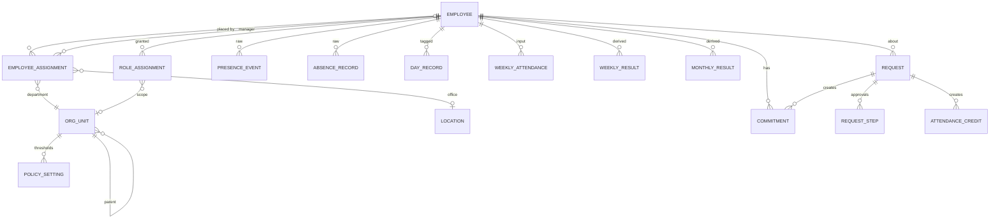

# Data model

Defined in `src/rto/models.py`. The schema is versioned with Alembic (`migrations/`). CI fails if the models and
the migrations drift apart (`alembic check`).

## Conventions

- **Effective dating**: `valid_from` is inclusive and `valid_to` is exclusive (`NULL` = open). Changes close the current row
  and open a new one, so history is kept and historical reports stay correct.
- Enumerations are stored as constrained strings (non-native enums), which makes migrations simple.
- Day counts are floats. The only fractional value is 0.5, which is exact in binary floating point.

## Entities

| Table | Purpose |
|---|---|
| `org_unit` | Company → department group → department. Unique `code` |
| `location` | Office (Ore Central, Three NEO, Spark, Vertis, local offices) |
| `employee` | Person master data; `in_scope` = tracked by the report; `ceo_level` (1 = ExCo, 2 = ExCo-1) |
| `employee_assignment` | Effective-dated department, **manager** and office. Drives visibility and approvals |
| `role_assignment` | Explicit roles (HR_ADMIN, HR_ANALYTICS, PEOPLE_PARTNER, EXECUTIVE, AUDITOR), optionally scoped to an org unit |
| `policy_setting` | Thresholds per org unit (or company when `org_unit_id` is NULL), effective-dated; NULL field = inherit |
| `commitment` | `BASELINE` (effective-dated), `EXEMPTION` (weeks), `DISPUTE` (weeks, after-dispute only) |
| `holiday` | Date, name, kind; `location_id` NULL = all offices |
| `excluded_period` | Waivers: `WEEK` mode (drop weeks) or `DAYS` mode (treat as holidays); scope by unit and/or office |
| `import_batch` | Every upload, with status and a JSON summary (warnings, reconciliation) |
| `presence_event` | Door / timekeeping / Wi-Fi events (raw) |
| `absence_record` | Leave / OB (raw), status and portion |
| `day_record` | Result of tagging: status, valid value, flags, sources |
| `weekly_attendance` | Valid days per employee-week. Input of the computation (`DAILY` or `REPORT_IMPORT`) |
| `attendance_credit` | Days credited by approved disputes |
| `weekly_result` | Per week: considered?, reason, working days, valid, commitment, met, plus after-dispute values |
| `monthly_result` | Per month: weeks met / considered, adherence, passed, threshold, plus a **snapshot** of department / manager / office |
| `report_month` | Lifecycle status, review deadline, finalization |
| `request`, `request_step` | Workflow: type, period, days, credited dates, category, reason; ordered approval steps |
| `audit_log` | Append-only record of every manual change, login, export and import |

## Volumes (estimate for 10,000 tracked employees)

| Table | Rows per year | Notes |
|---|---|---|
| `presence_event` | ~5–8 M | Largest table. Candidate for monthly partitioning and a retention policy (Q17) |
| `day_record` | ~3.65 M | |
| `weekly_result` | ~520 k | |
| `monthly_result` | 120 k | |
| `request` | tens of thousands | |

PostgreSQL handles this comfortably on a small managed instance (2–4 vCPU, 8–16 GB). For partitioning
`presence_event` / `day_record` by month, see the hardening checklist.
